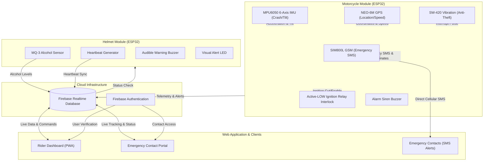

# VigiLERT — Intelligent IoT Motorcycle Safety & Anti-Theft System

[](https://vuejs.org/)
[](https://vitejs.dev/)
[](https://firebase.google.com/)
[](https://www.espressif.com/)
[](https://tailwindcss.com/)
[](https://web.dev/progressive-web-apps/)

**VigiLERT** is a comprehensive, IoT-powered motorcycle safety, emergency response, and anti-theft ecosystem. Combining dual microcontroller modules (one integrated into the helmet, one mounted on the motorcycle) with a cloud-connected Progressive Web App (PWA), VigiLERT enforces rider safety compliance, detects accidents and alcohol impairment, safeguards against vehicle theft, and automatically coordinates emergency alerts via cellular SMS and cloud telemetry.

---

## 📑 Table of Contents

- [System Architecture](#-system-architecture)
- [Key Functionalities & Features](#-key-functionalities--features)
  - [1. Smart Safety Interlock & Helmet Compliance](#1-smart-safety-interlock--helmet-compliance)
  - [2. Alcohol Impairment Detection](#2-alcohol-impairment-detection)
  - [3. Crash & Accident Detection](#3-crash--accident-detection)
  - [4. Anti-Theft & Tamper Protection](#4-anti-theft--tamper-protection)
  - [5. GPS Telemetry & Live Tracking](#5-gps-telemetry--live-tracking)
  - [6. Emergency Response & Contact Portal](#6-emergency-response--contact-portal)
- [Hardware Architecture & Pin Configurations](#-hardware-architecture--pin-configurations)
  - [Motorcycle Module (ESP32)](#motorcycle-module-esp32)
  - [Helmet Module (ESP32)](#helmet-module-esp32)
- [Software Stack](#-software-stack)
- [System Reaction Latency](#-system-reaction-latency)
- [Repository Structure](#-repository-structure)
- [Getting Started](#-getting-started)
  - [Web Application Setup](#web-application-setup)
  - [Firmware Deployment](#firmware-deployment)
  - [Environment & Credentials Security](#environment--credentials-security)
- [License](#-license)

---

## 🏗 System Architecture

The ecosystem operates across three interconnected tiers: the **Helmet Module**, the **Motorcycle Module**, and the **Web Application Dashboard**, synchronized in real time via **Firebase Realtime Database** with cellular SMS fallback.



---

## ⚡ Key Functionalities & Features

### 1. Smart Safety Interlock & Helmet Compliance
- **Physical Key Blocking**: An active-low relay wired in series with the motorcycle's ignition circuit enforces software-level authorization. When locked, the ignition is grounded or open-circuited, preventing physical key starts.
- **Continuous Helmet Heartbeat**: The helmet module transmits periodic heartbeat signals. If the helmet is disconnected or unbuckled during operation, the system cuts the ignition relay within ~6 seconds to prevent unhelmeted riding.

### 2. Alcohol Impairment Detection
- **Breath Analysis**: An MQ-3 gas sensor continuously evaluates breath ethanol concentration inside the helmet visor chamber.
- **Automatic Immobilization**: If alcohol readings exceed the threshold (ADC > 600), the system flags a `Danger` status, immediately cuts or blocks the ignition relay, sounds the helmet buzzer, and records an incident log to the database.

### 3. Crash & Accident Detection
- **Multi-Factor Impact Sensing**: An MPU6050 6-axis accelerometer and gyroscope measures sudden impact spikes (>15g total acceleration) and severe lean angles (>40° roll/tilt).
- **Automated Emergency Dispatch**: Upon accident confirmation:
  1. The ignition relay is cut immediately to mitigate fire hazards and runaway throttle.
  2. The SIM800L GSM module dispatches urgent SMS messages containing exact Google Maps GPS coordinates to all registered emergency contacts.
  3. Real-time crash telemetry is logged to Firebase for emergency portal dispatchers.

### 4. Anti-Theft & Tamper Protection
- **Auto-Arming Security**: 10 seconds after parking and turning off the engine, the anti-theft system arms automatically.
- **Hardware Interrupt Vibration Detection**: An SW-420 sensor wired to a hardware interrupt catches unauthorized tampering, lifting, or shaking even during network latency.
- **Siren & Geo-Alerts**: Triggers a dual-tone police siren sweep (700Hz–1700Hz) and dispatches an immediate anti-theft SMS alert containing the motorcycle’s coordinates.

### 5. GPS Telemetry & Live Tracking
- **High-Precision Mapping**: Integrated NEO-6M GPS streams latitude, longitude, and ground speed to the interactive Leaflet.js dashboard.
- **Deadband Speed Filtering**: A 3 km/h threshold filter eliminates GPS drift noise when stationary.
- **Trip Recording**: Full journey histories (starting point, destination, peak speed, route path, timestamps) are archived automatically.

### 6. Emergency Response & Contact Portal
- **Dual-View Web Interface**: Provides separate dashboards for riders and designated emergency contacts.
- **Dynamic Contact Management**: Contacts are fetched dynamically from the database—no hardcoding required in the firmware.
- **One-Click SOS & Remote Commands**: Authorized users can review historical breadcrumbs, initiate safety checks, or remotely toggle engine locks from the PWA.

---

## 🔧 Hardware Architecture & Pin Configurations

### Motorcycle Module (ESP32)

| Component | Interface / GPIO | Logic / Mode | Functional Description |
|---|---|---|---|
| **Ignition Relay Module** | `GPIO 13` | `OUTPUT` (Active-LOW) | Controls ignition coil circuit (LOW = run, HIGH = cut) |
| **Alarm Siren (Buzzer)** | `GPIO 14` | `OUTPUT` (`tone()`) | Audio alerts and anti-theft police-wail sweep |
| **Status LED** | `GPIO 2` | `OUTPUT` | Visual connection & armed state indication |
| **SW-420 Vibration Sensor** | `GPIO 15` | `INPUT_PULLUP` (Interrupt) | Detects unauthorized tampering / movement |
| **MPU6050 6-Axis IMU** | `GPIO 21` (SDA) / `GPIO 22` (SCL) | `I2C` | Impact G-force and tilt angle monitoring |
| **NEO-6M GPS Module** | `GPIO 16` (RX) / `GPIO 17` (TX) | `UART1` (9600 baud) | Live GPS coordinates and speed telemetry |
| **SIM800L GSM Module** | `GPIO 4` (RX) / `GPIO 5` (TX) | `UART2` (9600 baud) | Cellular SMS dispatch for crashes and alarms |

> [!NOTE]
> The motorcycle module is powered from the vehicle's 12V DC battery stepped down to 5V (3A minimum) via an efficient DC-DC buck converter.

---

### Helmet Module (ESP32)

| Component | Interface / GPIO | Logic / Mode | Functional Description |
|---|---|---|---|
| **MQ-3 Alcohol Sensor** | `GPIO 34` | `ADC INPUT` (Analog) | Samples breath ethanol vapor concentration |
| **Status Indicator LED** | `GPIO 2` | `OUTPUT` | Indicates pairing, warmup, and safety status |
| **Warning Buzzer** | `GPIO 5` | `OUTPUT` (`tone()`) | Local acoustic feedback for alcohol/safety alarms |

> [!NOTE]
> The helmet module is powered independently by a 3.7V rechargeable Lithium-Polymer (Li-Po) battery (2000mAh+) equipped with a TP4056 USB charging and protection circuit.

---

## 💻 Software Stack

| Layer | Technologies | Purpose |
|---|---|---|
| **Frontend Framework** | [Vue.js 3](https://vuejs.org/) (Composition API) | Reactive single-page web application |
| **Build & Tooling** | [Vite 5](https://vitejs.dev/) | Fast build system and Hot Module Replacement |
| **Styling & Design** | [Tailwind CSS 3](https://tailwindcss.com/) | Modern responsive user interface |
| **State Management** | [Pinia 2](https://pinia.vuejs.org/) | Centralized client-side state store |
| **Routing** | [Vue Router 4](https://router.vuejs.org/) | Client-side page navigation |
| **Mapping Engine** | [Leaflet.js 1.9](https://leafletjs.com/) | Interactive map rendering & route polylines |
| **Data Visualization** | [Chart.js 4](https://www.chartjs.org/) | Historical speed and trip telemetry charts |
| **PWA Layer** | [Vite PWA Plugin](https://vite-pwa-org.netlify.app/) | Offline precaching, app manifest, service workers |
| **Backend & Cloud** | [Firebase Realtime Database & Auth](https://firebase.google.com/) | Low-latency state sync (<500ms) & authentication |
| **Embedded Firmware** | C++ / Arduino ESP32 Core | Real-time sensor polling, interrupt handling, REST API |

---

## ⏱ System Reaction Latency

| Safety Event | Trigger Condition | System Action | Latency |
|---|---|---|---|
| **Alcohol Detected** | MQ-3 sensor ADC > 600 | Ignition blocked / engine cut + alert | `< 1.0 s` |
| **Helmet Disconnected** | Heartbeat lost while moving | Relay de-energized (engine cut) | `~ 6.0 s` |
| **Accident / Crash** | Impact > 15g or lean > 40° | Engine cut, GPS coordinates logged, SMS sent | `< 2.0 s` |
| **Theft / Tampering** | SW-420 triggered when armed | Local police siren + SMS with GPS link | `Instant` |
| **Network Interruption** | Wi-Fi lost while armed | Failsafe security interlock activated | `~ 15.0 s` |

---

## 📁 Repository Structure

```text
VigiLERT/
├── arduino/                               # Embedded C++ Firmware Sketches
│   ├── MotorcycleToWebApplication_FINAL.ino # Main motorcycle module firmware
│   ├── HelmetToWebApplication_FINAL.ino     # Main helmet module firmware
│   └── tests/                             # Hardware diagnostic routines
├── src/                                   # Vue 3 Frontend Source
│   ├── assets/                            # Brand assets, icons, and base styles
│   ├── components/                        # Reusable Vue components
│   │   ├── LocationSection.vue            # Live GPS map and telemetry display
│   │   ├── SensorHealthPanel.vue          # Hardware diagnostics & connection health
│   │   ├── SpeedDataSection.vue           # Speedometer & Chart.js visualizations
│   │   └── TripStatistics.vue             # Trip distance and duration analytics
│   ├── firebase/                          # Firebase SDK initialization
│   │   └── config.js                      # Config reader (uses environment variables)
│   ├── stores/                            # Pinia stores (auth, vehicle state)
│   ├── views/                             # Primary application pages
│   │   ├── Dashboard.vue                  # Main rider control and telemetry view
│   │   ├── EmergencyContactDashboard.vue  # Real-time tracking portal for contacts
│   │   ├── Login.vue                      # User authentication
│   │   └── Register.vue                   # User and device registration
│   ├── App.vue                            # Root Vue component
│   └── main.js                            # Application bootstrap
├── public/                                # Static PWA icons, manifest, and assets
├── docs/                                  # Extended technical guides & references
├── index.html                             # Single-page application entry point
├── package.json                           # Dependencies and project scripts
├── tailwind.config.js                     # Tailwind CSS design system rules
└── vite.config.js                         # Vite & PWA configuration
```

---

## 🚀 Getting Started

### Web Application Setup

1. **Clone the Repository:**
   ```bash
   git clone https://github.com/RyanClaud/VigiLERT.git
   cd VigiLERT
   ```

2. **Install Node Dependencies:**
   Ensure you are in the project root directory:
   ```bash
   npm install
   ```

3. **Configure Environment Variables:**
   Create a `.env` file in the root directory based on the template below:
   ```env
   VITE_FIREBASE_API_KEY=YOUR_FIREBASE_API_KEY
   VITE_FIREBASE_AUTH_DOMAIN=your-project-id.firebaseapp.com
   VITE_FIREBASE_DATABASE_URL=https://your-project-id-default-rtdb.firebaseio.com
   VITE_FIREBASE_PROJECT_ID=your-project-id
   VITE_FIREBASE_STORAGE_BUCKET=your-project-id.appspot.com
   VITE_FIREBASE_MESSAGING_SENDER_ID=YOUR_SENDER_ID
   VITE_FIREBASE_APP_ID=YOUR_APP_ID
   ```

4. **Run the Development Server:**
   ```bash
   npm run dev
   ```
   Open `http://localhost:5173` in your browser.

5. **Build for Production:**
   ```bash
   npm run build
   ```

---

### Firmware Deployment

1. Open the [Arduino IDE](https://www.arduino.cc/en/software) (version 2.0 or newer).
2. Install the **ESP32 board package** via Board Manager:
   - URL: `https://raw.githubusercontent.com/espressif/arduino-esp32/gh-pages/package_esp32_index.json`
3. Install required libraries using the Arduino Library Manager:
   - `ArduinoJson` (v6.x)
   - `Adafruit MPU6050`
   - `Adafruit Unified Sensor`
   - `TinyGPSPlus`
4. Open the respective sketches:
   - [Motorcycle Module Firmware](file:///c:/Users/Ryan/Desktop/VigiLERT/arduino/MotorcycleToWebApplication_FINAL.ino)
   - [Helmet Module Firmware](file:///c:/Users/Ryan/Desktop/VigiLERT/arduino/HelmetToWebApplication_FINAL.ino)
5. Set your network credentials and Firebase URL inside the firmware credentials block:
   ```cpp
   // Configuration Placeholders
   const char* WIFI_SSID     = "YOUR_WIFI_SSID";
   const char* WIFI_PASSWORD = "YOUR_WIFI_PASSWORD";
   const char* FIREBASE_HOST = "https://your-project-id-default-rtdb.firebaseio.com/";
   const char* USER_UID      = "YOUR_USER_FIREBASE_UID";
   ```
6. Select your ESP32 board and COM port, then click **Upload**.

---

### 🛡️ Environment & Credentials Security

> [!CAUTION]
> **Keep Credentials Confidential**
> - **Never commit secrets to source control**: Ensure `.env` and local configuration files containing database URLs, private API keys, or Wi-Fi passwords remain listed in `.gitignore`.
> - **Cellular Numbers**: Emergency contact phone numbers are configured via the authenticated Web Dashboard and synchronized over Firebase RTDB security rules—avoid hardcoding personal phone numbers in firmware sketches.
> - **Firebase Security Rules**: Apply rigorous read/write authentication checks on the `users/{uid}` and `helmet_public/{uid}` database paths to prevent unauthorized access.

---

## 📄 License

This project is developed as an academic capstone and safety research system. All rights reserved. Refer to repository licensing terms for commercial use or distribution.
